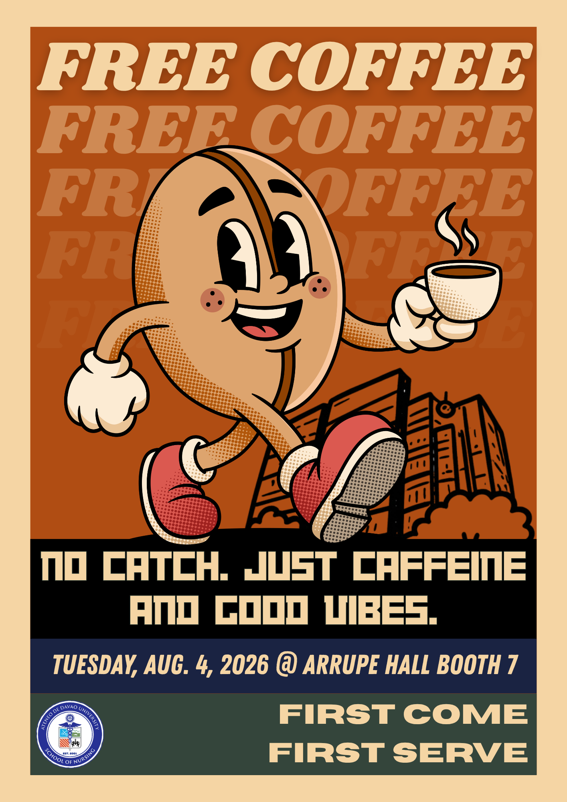

# Activity 1: Presentation Design Principles

> Discuss the design principles you applied and how they improved your presentation.

---

## What I Created

I created a vintage, rubber-hose style promotional poster for a "Free Coffee" event hosted by the Ateneo de Davao University School of Nursing.

## Why I Came Up With the Concept

I chose a coffee-themed concept because coffee is associated with energy, comfort, and social interaction. The playful character and bold wording make the event feel welcoming and enjoyable, especially for students.

## How I Developed My Final Output

I placed a central animated coffee bean mascot holding a cup to serve as the visual anchor. Behind it, I added repeating light typography ("FREE COFFEE") for texture, framed the bottom with high-contrast text blocks containing event details, and incorporated the official school seal for legitimacy.

## Design Principles Applied
I applied contrast, hierarchy, balance, repetition, alignment, and emphasis. The large “FREE COFFEE” title immediately catches attention, while the contrasting colors and repeated text create visual interest and consistency.

## How They Improved My Presentation

These principles make the poster visually engaging from a distance while ensuring the essential information, that is what, when, and where, is immediately readable and organized logically for the audience to see.

## What Have I Learned?

- **Key Concepts & Skills:** I learned how to apply core presentation design principles—contrast, visual hierarchy, balance, repetition, alignment, and emphasis—to turn a simple event announcement into an eye-catching promotional poster.
- **Challenge & Solution:** Balancing the playful vintage mascot and repeating background text without making the event details hard to read was challenging; I solved this by placing the key details in high-contrast text blocks at the bottom.
- **Future Application:** I can apply these layout and hierarchy principles when designing future nursing health-education posters, patient handouts, and academic presentations.

