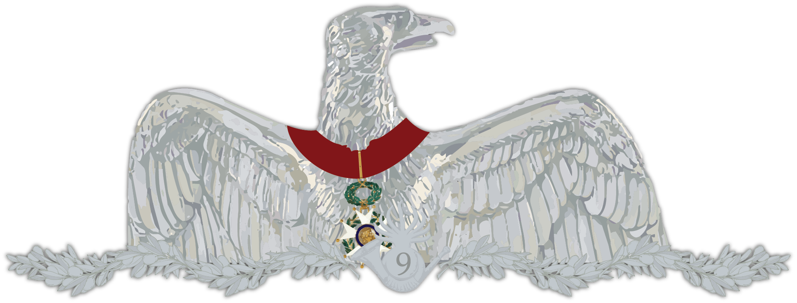
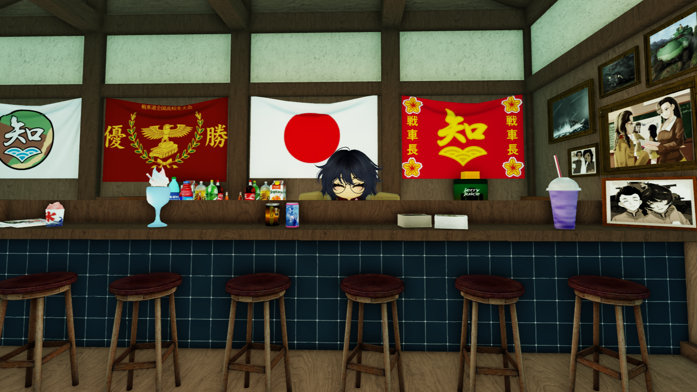
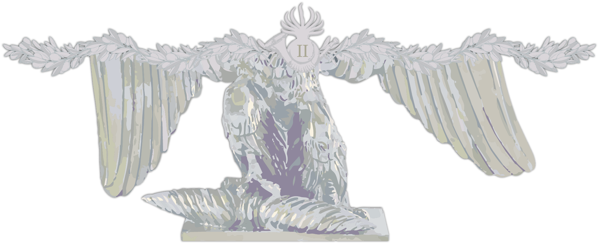

# 21st Century IT Skills Digital Portfolio — Joe Elord C. Cermino
 

 

## About Me

**Name:** Joe Elord C. Cermino  
**Course & Year Level:** Bachelor of Science in Nursing (BSN), 4th Year (Class of 2027)  
**School:** Ateneo de Davao University  

I am a Student Nurse at Ateneo de Davao University with broad clinical exposure across medical-surgical, perioperative, emergency, maternal and child, and psychiatric nursing in tertiary and community settings. I am a Dean's List awardee and Basic Life Support (BLS) certified, with a strong interest in combining clinical nursing practice with modern digital tools, visual communication, and healthcare technology.

## Skills & Tools Learned

- **Version Control & Documentation:** Git, GitHub, Markdown
- **Visual Design & Presentations:** Presentation design principles, color palette & typography, social media infographics, Google Slides
- **AI & Productivity:** Prompt engineering and comparative LLM evaluation (ChatGPT, Gemini, Claude)
- **Web Development:** AI-assisted static website creation, asset management, Replit, and GitHub Pages

 

## Activities and Submissions

> Click the activity links in the table below to navigate to each activity's documentation.

| # | Activity | Topic |
|---|----------|-------|
| 1 | [Activity 1: Presentation Design Principles](Activity-1/README.md) | Design principles applied and how they improved the presentation |
| 2 | [Activity 2: Color Palette and Typography](Activity-2/README.md) | Chosen colors and typography and why they were selected |
| 3 | [Activity 3: Social Media Infographics and Mini Project Documentation](Activity-3/README.md) | Output concept, design choices, and creative process |
| 4 | [Activity 4: Google Slides Interactive Presentation](Activity-4/README.md) | Collaborative Google Slides presentation and interactive quiz game |
| 5 | [Activity 5: Exploring and Improving AI Prompts](Activity-5/README.md) | Iterative prompt refinement and output comparison using Gemini |
| 6 | [Activity 6: Personal Resume Website](Activity-6/README.md) | One-page interactive nursing resume website via AI-assisted web development |
| 7 | [Activity 7: Comparative Resume Generation using Multiple LLMs](Activity-7/README.md) | Comparing ClaudeAI and ChatGPT outputs for resume generation |

 

## Reflection: Building and Managing This Digital Portfolio

### How I Created and Set Up the GitHub Repository

I started by creating a new repository on GitHub under my account and initializing it with a `README.md` so it would have a landing page from the start.

### How I Organized My Activities and Outputs

Each activity is organized into its own dedicated folder (`Activity-1` through `Activity-7`), containing the activity output (images or PDFs) and a `README.md` with the activity overview and reflection. This root `README.md` serves as the portfolio's main About Me page and table of contents.

### Challenges Encountered and How I Addressed Them

- **File naming consistency** — Early on, inconsistent casing for image files caused broken links on case-sensitive systems. I standardized filenames and updated Markdown references accordingly.
- **Large image sizes** — High-resolution screenshots were slow to load, so I compressed them before committing to keep the repository lightweight.
- **README structure** — Organizing the portfolio into a clean About Me section and a structured activity table made the repository easy to navigate at a glance.
 
